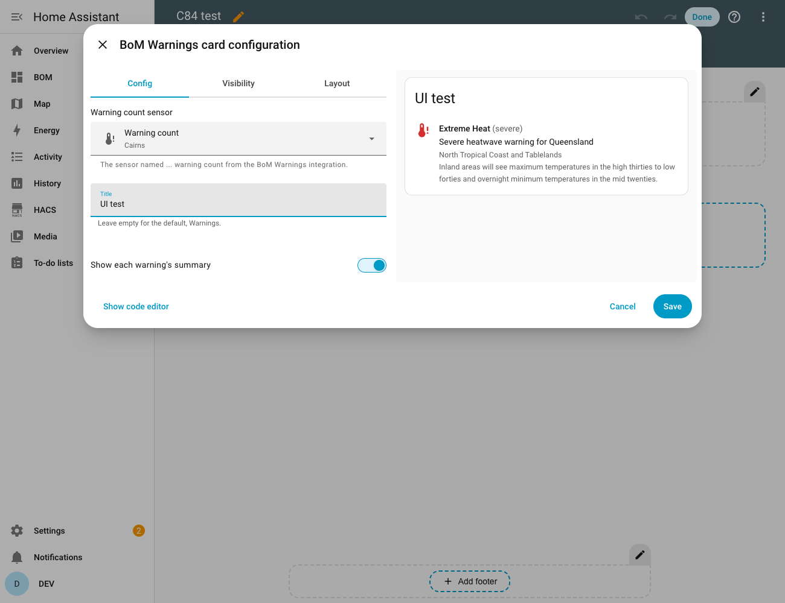
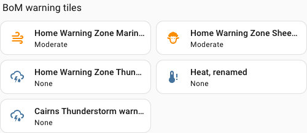
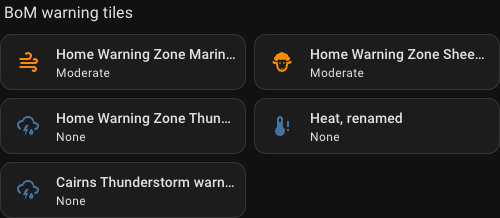

# BoM Warnings Card

Two Lovelace cards for the [BoM Warnings](https://github.com/rhgof/ha-bom-warnings) integration,
which brings Bureau of Meteorology warnings into Home Assistant:

- **BoM Warnings** (`custom:bom-warnings-card`) lists the warnings for a location, most severe
  first, each with an icon in the colour of its severity.
- **BoM Warning Tile** (`custom:bom-warning-tile`) is one warning type as a tile, with its icon in
  the colour of the current severity.

| Light | Dark |
| --- | --- |
|  |  |

## Contents

- [Key features](#key-features)
- [Install](#install)
- [BoM Warnings card](#bom-warnings-card-1): the ranked list, its options and the editor
- [Warning tile](#warning-tile): one warning type as a tile
- [Development](#development)

## Key features

- **The worst warning first.** The list is in the integration's own order, so what matters most to
  your location is at the top. The card does not re-sort.
- **Severity you can read at a glance.** Each warning has an icon in the colour of its level, in
  light and dark themes.
- **Says which area a warning is for.** Each warning shows the names of your location's areas it
  covers (for example `Illawarra`), so a warning for the next district over looks different from
  one for yours.
- **Choose what each row shows.** The headline, the areas, the summary, and the level and phase can
  each be switched off.
- **Tap for detail.** Tapping the card shows or hides every warning's summary, so the list stays
  short until you want the detail.
- **Ended warnings are dimmed.** A warning that has gone `final` or `cancelled` (if you keep those in
  the integration's options) says so instead of looking current. With no warnings the card says so.
- **A tile for each warning type**, for a compact row of thunderstorm, flood, fire weather and so on.
  It is Home Assistant's own tile, so tapping opens the sensor's history and you keep all of the
  tile's options.
- **Set up from the dashboard.** Pick the card from the card picker and choose a location. No YAML
  or template is needed.
- **Starts on a warning.** A new card chooses a sensor that has a warning, not whichever is listed
  first.

## Install

You need the [BoM Warnings integration](https://github.com/rhgof/ha-bom-warnings) set up first:
the card reads its warning count sensor.

1. In HACS, open the menu, choose **Custom repositories**, add
   `https://github.com/rhgof/ha-bom-warnings-card` with the category **Dashboard**.
2. Download **BoM Warnings Card**, then hard-refresh the browser. The card's file is cached for a
   long time, so a page opened before an update keeps the old card until you do.

To update later, open the card in HACS, choose **Update information** from its menu, then
**Update**.

## BoM Warnings card

Edit a dashboard, choose **Add card**, open the **By card** tab and pick **BoM Warnings**. The
editor starts with one of your warning count sensors already chosen.



Or write it in YAML:

```yaml
type: custom:bom-warnings-card
entity: sensor.home_warning_count
```

| Option | Default | |
| --- | --- | --- |
| `entity` | required | The integration's warning count sensor. For an entry titled `Home` it is `sensor.home_warning_count`. |
| `title` | `Warnings` | The card's header. |
| `show_headline` | `true` | Set to `false` to leave out each warning's headline. |
| `show_area` | `true` | Set to `false` to leave out the names of the areas each warning covers. |
| `show_summary` | `true` | Whether the summaries are showing when the card loads. Set to `false` to start with them hidden. |
| `show_level` | `true` | Set to `false` to leave out each warning's level and phase, for example `(moderate, final)`. An ended warning is still dimmed. |

The event name and icon always show. Each option is in the card's editor too, so none of them needs
YAML.

### Tapping the card

A tap shows or hides the summary under every warning. `show_summary` only sets where it starts: a
reload goes back to that, and each card keeps its own state. The card is a button for the keyboard
and screen readers (Enter or Space toggles it) only while at least one warning has a summary. With
no warnings, an unavailable sensor, or no summaries to show, a tap does nothing.

Before this, `show_summary: false` meant the summaries never showed. Now a tap shows them, so a card
set that way is no longer limited to the short view.

If you would rather not install a card, the integration's
[dashboard guide](https://github.com/rhgof/ha-bom-warnings/blob/main/docs/dashboard.md) has a
ready-made section built from Home Assistant's own cards.

## Warning tile

One warning type (thunderstorm, flood, marine wind and so on) as a tile, with the icon in the colour
of the sensor's current severity. A type with no warning keeps the tile's usual colour.

| Light | Dark |
| --- | --- |
|  |  |

Edit a dashboard, choose **Add card**, open the **By card** tab and pick **BoM Warning Tile**, or:

```yaml
type: custom:bom-warning-tile
entity: sensor.home_thunderstorm_warning
```

`entity` is one of the integration's per-type warning sensors (`sensor.<title>_<type>_warning`, for
example `sensor.home_extreme_heat_warning`, which is the Heatwave warning). The integration must be
recent enough for those sensors to have a `color` attribute.

It also works on the **Most severe warning** sensor (`sensor.<title>_most_severe_warning`), coloured
by whichever warning is on top. Its state is a headline, not a level, so its title gets no level.

And on the integration's **fire danger** sensors (`sensor.<title>_fire_danger_today` and
`..._tomorrow`), coloured by the rating with BoM's own legend: grey for no rating, green for
moderate, yellow for high, orange for extreme and red for catastrophic. A rating is not a warning
level, so these titles stay plain.

The tile is Home Assistant's own, so everything a tile has is there: tapping opens the sensor's
history and activity, and the editor has the tile's own name, icon, state content (add the
headline, summary or area), layout, interactions and features.

- **Colour.** While a warning is active its severity colour is used, even if the tile's **Colour**
  option is set. With no warning, that option (or the tile's default) applies.
- **Level in the title.** While a warning is active the level goes in front of the sensor's name, so
  the title reads, for example, "Severe Heatwave warning" or "Moderate Severe weather warning". With
  no warning the title is the plain name. A name you set in the editor (your own text, or the
  device or area name) is used as it is, with no level added.
- **Defaults.** A tile's **Name** is **Entity** alone, so the location's name is not in front of it
  (it is already the card's heading). A warning sensor's **State content** is the state and the
  headline, which a new tile starts with and an existing tile without either set now gets too.
  Fire danger ratings and the Most severe sensor keep the tile's own content, because they have no
  headline of their own to show. Anything you set in the editor wins. The state line shows the level
  too, so take `state` out of the content if you want only the headline.
- **Hide when there is no warning.** Use the editor's **Visibility** tab and show the card only when
  the state is not `none`.
- **Home Assistant versions.** It was checked on Home Assistant 2026.10.4 only, so check the tile
  after an upgrade. Why it is sensitive to upgrades is in [docs/development.md](docs/development.md).

## Development

Building, testing and how the card relates to the integration are in
[docs/development.md](docs/development.md).
