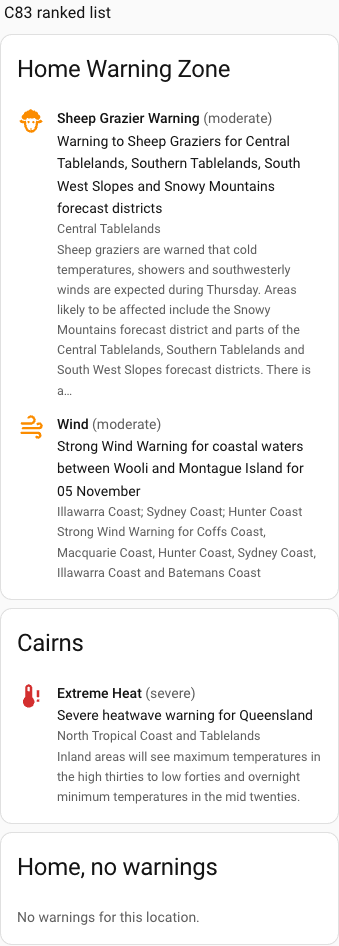
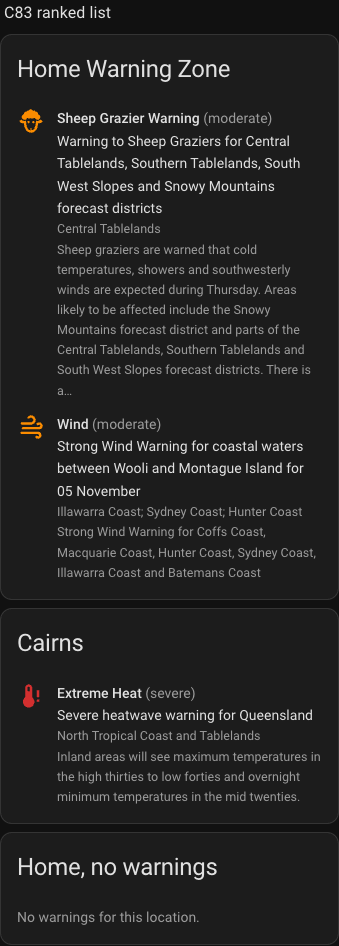

# BoM Warnings Card

A Lovelace card for the [BoM Warnings](https://github.com/rhgof/ha-bom-warnings) integration. It
lists the Bureau of Meteorology warnings for a location, most severe first, each with an icon in
the colour of its severity.

| Light | Dark |
| --- | --- |
|  |  |

Each warning shows its event, level, headline, the names of your location's areas it covers, and a
short summary. A warning that has ended (`final` or `cancelled`, if you keep those in the
integration's options) is dimmed and says so. With no warnings the card says so.

## Install

1. In HACS, open the menu, choose **Custom repositories**, add
   `https://github.com/rhgof/ha-bom-warnings-card` with the category **Dashboard**.
2. Download **BoM Warnings Card**, then reload the browser.

## Use

Add a card of type `custom:bom-warnings-card`, or pick **BoM Warnings** from the card picker:

```yaml
type: custom:bom-warnings-card
entity: sensor.home_warning_count
```

| Option | Default | |
| --- | --- | --- |
| `entity` | required | The integration's warning count sensor. For an entry titled `Home` it is `sensor.home_warning_count`. |
| `title` | `Warnings` | The card's header. |
| `show_summary` | `true` | Set to `false` to leave out each warning's summary. |

The order is the integration's own ranking. The card does not re-sort.

## Develop

```sh
npm install
npm test
npm run build   # writes dist/bom-warnings-card.js, which HACS serves, so commit it
```

`tests/fixtures/states.json` is a copy of the integration's
`tests/fixtures/dashboard/states.json`, the shared description of the attributes the card reads.
The integration's own tests check that file against what it really produces, and this repo's CI
fails if the copy falls behind. Copy it again when the integration's attributes change.
